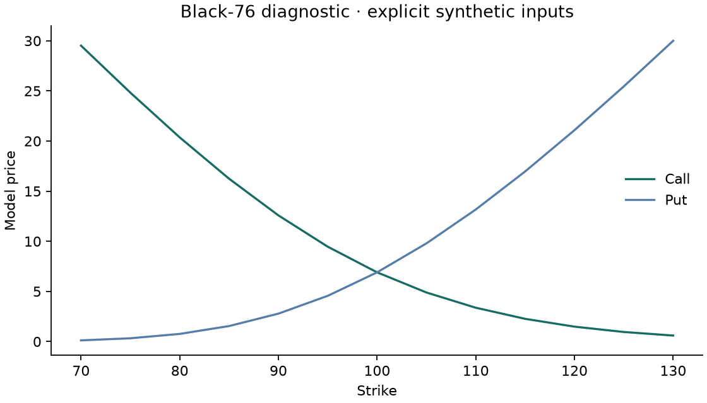

# Indian option data and pricing study

Collect NSE option data, fit volatility surfaces and evaluate pricing and forecasting baselines.

**Offline checks verify Black-76 put–call parity and implied-volatility round trips.** TODO: saved market-data forecast accuracy; no predictive-performance number has been validated.



## Quick start

From the repository root, without market downloads:

```bash
python3 -m venv .venv
.venv/bin/pip install -r requirements-dev.txt
.venv/bin/python -m pytest -q
```

`python fetch_bhavcopy.py --help` describes daily and backfill downloads. `snapshot_chain.py` collects intraday chains. `NSE_DATA_ROOT` overrides the default local data directory. Provider redistribution permission has not been established, so no NSE sample is bundled. `requirements-neural.txt` adds optional PyTorch and Yahoo Finance tools; the core setup does not need them.

## Method

- Download UDiFF bhavcopy archives and normalize them into Parquet.
- Save option-chain snapshots during the configured weekday market-hours window.
- Estimate forwards from put–call parity and solve Black-76 implied volatility.
- Fit SVI volatility surfaces and check shape constraints.
- Build forecasting and option-price backtests from locally generated surfaces.
- Keep raw archives and derived results under the configured data root.

## Results

[Diagnostic inputs and outputs](results/pricing_diagnostic.json) contain actual Black-76 calculations on explicitly synthetic inputs. The chart compares call and put model prices across strikes; it does not use market observations or measure forecast skill. Run `python scripts/pricing_diagnostic.py` to reproduce it.

## What didn't work

The prior setup referred to missing scheduler files and omitted dependencies; those instructions are repaired. Systemd units remain absent. The snapshot clock excludes weekends but has no exchange-holiday calendar. Downloads can fail when NSE endpoints or archive schemas change. Forecast quality and the neural model have not been validated in this cleanup.

## Tests, structure and licence

[](https://github.com/VChahar1/Indian-Option-price-predictor/actions/workflows/tests.yml)

`tests/` checks pricing identities without network access. Root scripts handle collection, normalization, surfaces and forecasts. `sanity_checks.py` needs local surface data; it is separate from unit tests. `scripts/` generates the diagnostic and `results/` stores its evidence. Code: [MIT](LICENSE); market data retain their provider's terms.
